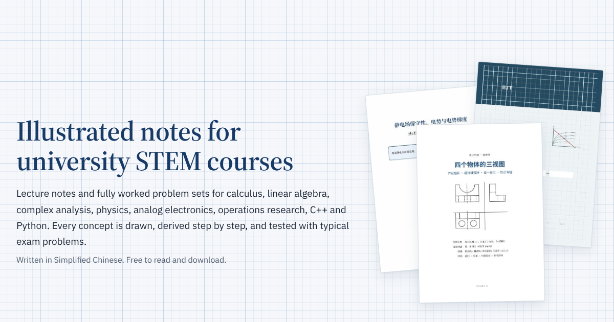

# Visual Study Notes · 大学课程可视化讲义

Illustrated lecture notes and fully worked problem sets for university STEM courses. 
数学、物理、电子、运筹学、编程与英语课程的可视化讲义与习题详解。

**138 PDFs · 5,919 pages · 17 courses**

**[Browse the library online / 在线浏览](https://xuanberns-design.github.io/visual-study-notes/)** — covers, search and filters, opens any PDF in one click.

> The handouts are written in Simplified Chinese. 讲义正文为简体中文。
>
> If they help you, a star makes it easier for other students to find them. 觉得有用的话欢迎点 Star。

## Course index · 课程目录

### 数学 · Mathematics

| Course 课程 | Lecture notes 专题讲义 | Problem sets 习题解析 | Pages 页数 |
|---|:---:|:---:|---:|
| [复变函数与积分变换](01-%E6%95%B0%E5%AD%A6/%E5%A4%8D%E5%8F%98%E5%87%BD%E6%95%B0%E4%B8%8E%E7%A7%AF%E5%88%86%E5%8F%98%E6%8D%A2/README.md) Complex Analysis & Integral Transforms | 9 | 10 | 787 |
| [数学分析](01-%E6%95%B0%E5%AD%A6/%E6%95%B0%E5%AD%A6%E5%88%86%E6%9E%90/README.md) Mathematical Analysis | 2 | — | 62 |
| [概率论与数理统计](01-%E6%95%B0%E5%AD%A6/%E6%A6%82%E7%8E%87%E8%AE%BA%E4%B8%8E%E6%95%B0%E7%90%86%E7%BB%9F%E8%AE%A1/README.md) Probability & Statistics | 7 | — | 254 |
| [高等代数](01-%E6%95%B0%E5%AD%A6/%E9%AB%98%E7%AD%89%E4%BB%A3%E6%95%B0/README.md) Advanced Algebra | 5 | — | 148 |

### 物理 · Physics

| Course 课程 | Lecture notes 专题讲义 | Problem sets 习题解析 | Pages 页数 |
|---|:---:|:---:|---:|
| [大学物理](02-%E7%89%A9%E7%90%86/%E5%A4%A7%E5%AD%A6%E7%89%A9%E7%90%86/README.md) University Physics | 12 | 3 | 606 |

### 电子与工程 · Electronics & Engineering

| Course 课程 | Lecture notes 专题讲义 | Problem sets 习题解析 | Pages 页数 |
|---|:---:|:---:|---:|
| [工程制图](03-%E7%94%B5%E5%AD%90%E4%B8%8E%E5%B7%A5%E7%A8%8B/%E5%B7%A5%E7%A8%8B%E5%88%B6%E5%9B%BE/README.md) Engineering Drawing | 6 | 3 | 459 |
| [模拟电子技术基础](03-%E7%94%B5%E5%AD%90%E4%B8%8E%E5%B7%A5%E7%A8%8B/%E6%A8%A1%E6%8B%9F%E7%94%B5%E5%AD%90%E6%8A%80%E6%9C%AF%E5%9F%BA%E7%A1%80/README.md) Analog Electronics | 14 | 5 | 799 |
| [运筹学](03-%E7%94%B5%E5%AD%90%E4%B8%8E%E5%B7%A5%E7%A8%8B/%E8%BF%90%E7%AD%B9%E5%AD%A6/README.md) Operations Research | 14 | 3 | 699 |

### 计算机与AI · Computing & AI

| Course 课程 | Lecture notes 专题讲义 | Problem sets 习题解析 | Pages 页数 |
|---|:---:|:---:|---:|
| [C++](04-%E8%AE%A1%E7%AE%97%E6%9C%BA%E4%B8%8EAI/C%2B%2B/README.md) C++ | 12 | — | 540 |
| [C语言](04-%E8%AE%A1%E7%AE%97%E6%9C%BA%E4%B8%8EAI/C%E8%AF%AD%E8%A8%80/README.md) C Programming | 1 | — | 28 |
| [Python](04-%E8%AE%A1%E7%AE%97%E6%9C%BA%E4%B8%8EAI/Python/README.md) Python | 4 | 1 | 223 |
| [人工智能与大模型](04-%E8%AE%A1%E7%AE%97%E6%9C%BA%E4%B8%8EAI/%E4%BA%BA%E5%B7%A5%E6%99%BA%E8%83%BD%E4%B8%8E%E5%A4%A7%E6%A8%A1%E5%9E%8B/README.md) Machine Learning & LLMs | 4 | — | 301 |
| [数据结构与算法](04-%E8%AE%A1%E7%AE%97%E6%9C%BA%E4%B8%8EAI/%E6%95%B0%E6%8D%AE%E7%BB%93%E6%9E%84%E4%B8%8E%E7%AE%97%E6%B3%95/README.md) Data Structures & Algorithms | 7 | 5 | 639 |

### 英语 · English

| Course 课程 | Lecture notes 专题讲义 | Problem sets 习题解析 | Pages 页数 |
|---|:---:|:---:|---:|
| [大学英语六级](05-%E8%8B%B1%E8%AF%AD/%E5%A4%A7%E5%AD%A6%E8%8B%B1%E8%AF%AD%E5%85%AD%E7%BA%A7/README.md) CET-6 English | 6 | — | 279 |
| [学术英语与论文阅读](05-%E8%8B%B1%E8%AF%AD/%E5%AD%A6%E6%9C%AF%E8%8B%B1%E8%AF%AD%E4%B8%8E%E8%AE%BA%E6%96%87%E9%98%85%E8%AF%BB/README.md) Academic English | 1 | 2 | 53 |
| [考研英语](05-%E8%8B%B1%E8%AF%AD/%E8%80%83%E7%A0%94%E8%8B%B1%E8%AF%AD/README.md) Graduate Entrance English | 1 | — | 9 |

### 党团学习 · Political Study

| Course 课程 | Lecture notes 专题讲义 | Problem sets 习题解析 | Pages 页数 |
|---|:---:|:---:|---:|
| [入党积极分子](06-%E5%85%9A%E5%9B%A2%E5%AD%A6%E4%B9%A0/%E5%85%A5%E5%85%9A%E7%A7%AF%E6%9E%81%E5%88%86%E5%AD%90/README.md) Political Theory Essays | 1 | — | 33 |

## Preview · 预览

<table>
<tr><td align="center" width="25%"> 复变函数的积分：基础可视化讲义与38题详解</td><td align="center" width="25%"> 大学物理·电磁感应 基础学习讲义</td><td align="center" width="25%"> 栈与队列：可视化专题讲义</td><td align="center" width="25%"> 对偶理论与灵敏度分析：可视化基础学习讲义</td></tr>
<tr><td align="center" width="25%"> 语言大模型 从RNN到Transformer 可视化专题讲义</td><td align="center" width="25%"> 组合体 基础学习讲义</td><td align="center" width="25%"> Python实验1-15 全解析学习讲义</td><td align="center" width="25%"> 模拟电子技术 差分放大到功率放大 基础学习讲义</td></tr>
</table>

## How each handout is built · 讲义结构

Every topic follows the same path: **definition → intuition → formula → common mistakes → worked examples**.
每个专题按「定义 → 直觉 → 公式 → 易错点 → 典型例题」展开，多数讲义附分层练习和逐步详解。

Each course is split into two kinds of material. 每门课分为两类：

- **Lecture notes 专题讲义**: concepts with diagrams, flowcharts and comparison tables.
- **Problem sets 作业与习题解析**: homework and exam-style problems with every step written out.

## How to use · 使用方式

- Review a course: open it in the index above and start with the lecture notes. 系统复习：先看专题讲义。
- Check your homework: open the problem sets of the same course. 对照作业：看同一门课的习题解析。
- Read on a phone: use the [online library](https://xuanberns-design.github.io/visual-study-notes/). 手机阅读：打开在线浏览页面。
- Download everything: **Code → Download ZIP**. 全部下载：点 Code → Download ZIP。

## Feedback · 反馈

Found an error or want a course added? Open an [issue](https://github.com/xuanberns-design/visual-study-notes/issues). 发现错误或想要新课程，欢迎提 Issue。

## License · 版权

[CC BY-NC-SA 4.0](LICENSE): share and adapt with attribution, non-commercial only. 可以自由学习和转发，请注明出处，禁止商用。
Some problems come from coursework and public textbooks and are shared for study only; open an issue for removal requests. 部分题目来源于课程作业与公开教材，仅供学习交流，如有侵权请提 Issue 联系删除。
